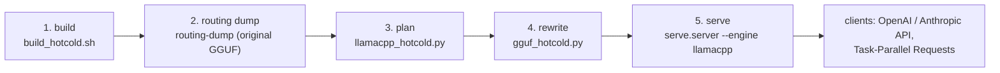

# Hot/cold MoE experts on llama.cpp, served by Strata Void

One flow from a mixture-of-experts GGUF to a running Strata Void server that keeps the experts the router actually
uses on the GPUs and the rarely used ones in host RAM. It is how GLM-5.3-Flash and DeepSeek V4 Flash run today:
the native Strata engine has no layers for them ([MOE_PLACEMENT.md](MOE_PLACEMENT.md#what-is-missing-for-real-glm--deepseek-inference)),
llama.cpp does. Why it pays, and how the pieces work, is in [MOE_PLACEMENT.md](MOE_PLACEMENT.md#running-it-today-hotcold-experts-in-llamacpp).



| step | input | output | needs |
|---|---|---|---|
| 1. build | the pinned llama.cpp + `patches/llama.cpp-moe-hot-cold-experts.patch` | `llama-server`, `ggml-rpc-server`, `routing-dump` | git, CMake, oneAPI (SYCL) and/or the CUDA toolkit |
| 2. routing dump | the original GGUF, a text file like your traffic | a routing trace (expert ids per token; never text) | the model loaded once (as large as serving it) |
| 3. plan | GGUF header, trace, per-device budgets | `cold.json` + the `--device/--tensor-split/-ot` arguments | Python only |
| 4. rewrite | original GGUF + `cold.json` | `MODEL-hotcold.gguf` (byte-exact copy, experts split) | disk for one more copy of the model |
| 5. serve | the hot/cold GGUF + a server config | an OpenAI / Anthropic endpoint | the GPUs and RAM the plan budgeted |

## 1. Build

```bash
tools/llamacpp/build_hotcold.sh                  # SYCL + RPC (Intel GPUs; sources oneAPI's setvars.sh if needed)
tools/llamacpp/build_hotcold.sh --cuda           # SYCL + CUDA + RPC
tools/llamacpp/build_hotcold.sh --cpu            # CPU + RPC (no GPU toolkit)
tools/llamacpp/build_hotcold.sh --check          # clone + check that the patch applies, build nothing
```

It clones `unslothai/llama.cpp` (branch `glm5next/upstream`, the one that runs both models) at the pinned commit
`86ebfef`, applies the patch, and builds into `third_party/llama.cpp-hotcold/build/bin/`. A checkout at another
commit, or with local edits the patch conflicts with, stops with the reason. `--source DIR` clones from an existing
local llama.cpp clone (offline), `--dir` puts the checkout elsewhere, `CMAKE_EXTRA="..."` adds CMake options.
The patched build runs original GGUFs exactly as before, so the same binary serves steps 2 and 5.

## 2. Routing dump

```bash
third_party/llama.cpp-hotcold/build/bin/routing-dump -m MODEL-00001-of-0000N.gguf \
    --device SYCL0,SYCL1,SYCL2 --split-mode layer -ngl all --ctx-size 2048 \
    -f calibration.txt --chunk 1024 --out routing.bin
```

It takes llama.cpp's usual options (devices, `--rpc`, `--tensor-split`, `-ot`), so any layout that loads the model
works; it runs the text through the model and records which experts each MoE layer selects. Use text like your
traffic (code, documents, languages): measured on a 16-31K-token mix, GLM's top 85% of experts carried 96.2% of
the activations, DeepSeek's 97.6%. DeepSeek's hash-routed layers 0-2 follow the token distribution of whatever text
is used. Several traces can be merged in step 3 (`--trace` repeats).

## 3. Plan

```bash
python tools/moe_placement/llamacpp_hotcold.py MODEL-00001-of-0000N.gguf --trace routing.bin --ctx 65536 \
    --device SYCL0=28.5GiB --device SYCL1=28.5GiB --device SYCL2=20GiB --ram 20GiB --out-cold cold.json
```

Devices are listed in layer order with the bytes each may use for weights + KV (leave room for compute buffers and
the driver); `--ram` bounds the cold parts in host RAM; `--kv-scale` scales the adapter's f16 KV estimate (0.53 for
q8_0 KV). Every contiguous layer split is tried, each device filled with its own layers' most-routed experts, and
the split with the fewest cold activations that fits wins. It prints the cold share and the arguments for step 5:

```
cold: <N> experts in <L> layers, <X> GiB RAM, <Y>% of measured activations
--device SYCL0,SYCL1,SYCL2 --split-mode layer --tensor-split 15,14,12 -ot ffn_.*_exps_cold\.=CPU
layers per device: {'SYCL0': 14, 'SYCL1': 14, 'SYCL2': 11}
```

(For GLM-5.3-Flash on three Arc Pro GPUs plus two GPUs on a second host it put 17.7 GiB of experts, 3.0% of the
measured activations, in host RAM.)

**CUDA devices** (local, or llama.cpp RPC workers): CUDA's `mul_mat_id` needs distinct expert ids per token, so a
split layer placed on CUDA needs one zero expert per routing slot: `--slot-zeros DEVICE` (the planner then prints
`rewrite with: --slot-zeros A-B` for step 4). `--no-split DEVICE` keeps a device's layers whole instead (no cold
part), which is the layout the measurements below used for the CUDA RPC devices. SYCL and CPU need neither.

## 4. Rewrite

```bash
python tools/moe_placement/gguf_hotcold.py MODEL-00001-of-0000N.gguf --cold cold.json --out MODEL-hotcold.gguf
#   add --slot-zeros A-B when step 3 printed it
```

Every split layer's `ffn_{gate,up,down}_exps` become `_hot` and `_cold` tensors plus two id tables; everything else
is copied byte for byte (tested; on the real models 90 random expert slices each were checked against the source).
A sharded input is read across its shards; the output is one file.

## 5. Serve

Copy [examples/llamacpp-hotcold/server.json](../examples/llamacpp-hotcold/server.json), put in the model path and
the arguments step 3 printed, then:

```bash
python -m serve.server --engine llamacpp --config my-hotcold.json --port 8095
```

Strata Void starts `llama-server` on a private loopback port with a random key, waits until the model is loaded
(`start_timeout_s`), and then answers on its own port: `/v1/chat/completions`, `/v1/completions`, `/v1/responses`,
`/v1/embeddings` (OpenAI), `/v1/messages` (Anthropic), streamed or whole, passed through to llama-server, whose chat
template (`--jinja`), tool-call parsing and reasoning handling apply. `GET /health` and `/v1/models` answer without
loading; `/props`, `/slots`, `/metrics`, `/tokenize`, `/apply-template` are passed through; llama-server's other
routes (slot save/restore to disk, LoRA) are not reachable.

| config key | meaning |
|---|---|
| `exe`, `model`, `args` | the llama-server binary, the GGUF, its options (relative paths are `cwd`'s). Not `--host`, `--port`, `--api-key`: Strata Void sets those |
| `hotcold` | `"auto"` (default): a GGUF with `_exps_hot` tensors, or an `-ot ..._exps_cold...` rule, is hot/cold and gets `--no-op-offload` |
| `model_name`, `aliases` | the names `/v1/models` lists (also llama-server's `--alias`) |
| `api_key`, `host`, `allowed_hosts` | as for the native engine: the key clients send, the listening address, extra host names |
| `lazy_load`, `idle_unload_s` | load on the first request; unload after this many idle seconds (the next request loads again) |
| `min_free_ram_mib` | refuse to load (503) while less host RAM than this is available (the cold experts live there) |
| `before_load` | a command run before every load; a non-zero exit refuses the load (e.g. "is another model resident?") |
| `log`, `env`, `start_timeout_s`, `request_timeout_s` | llama-server's log file, extra environment, load and request timeouts |
| `thinking_kwarg` | the `chat_template_kwargs` key that switches thinking for Task-Parallel's internal requests (default `enable_thinking`; `null`: leave it to the template) |
| `task_parallel` | as for the native engine ([TASK_PARALLEL.md](TASK_PARALLEL.md)): `{"default": "auto", "max_workers": 2}` |

**Task-Parallel Requests** work through the same `Backend` protocol as on the native engine (`LlamaCppBackend` in
`serve/llamacpp.py`): a request with `"task_parallel": 2` (or `"auto"`, or the config's default) is planned, its
subtasks run at once in llama-server's slots, and only the answer is returned, with the `task_parallel` object.
Slots come from `--parallel N`, and each slot gets `--ctx-size / N` tokens: a long shared document needs a slot that
holds it. llama-server reuses each slot's cached prompt prefix by itself; there is no checkpoint hint as on the
native engine. Requests with tools, images or a structured `response_format` take the ordinary path.

A client that disconnects cancels its request in llama-server (a streamed one at once; a whole answer when
llama-server next checks its connection, within a few seconds). When llama-server dies, a running stream ends with an
error event and the next request starts it again. The process stops with Strata Void (Ctrl+C or SIGTERM).

## Rules the patched runtime needs

- **`--no-op-offload`** for hot/cold GGUFs: op offload copies the experts named by ids read before the split
  computes them (a GGML_ASSERT on long prompts otherwise). Strata Void adds it; a hand-written launch must too.
- **CUDA split layers need per-slot zero experts** (`--slot-zeros`, steps 3-4), else CUDA's `mul_mat_id` reads an
  uninitialised entry (illegal memory access). SYCL and CPU work with one zero expert.
- The cold part runs in every split layer even when no cold expert is selected (one expert's bytes per layer per
  token); avoiding that needs a runtime skip in the backend's `mul_mat_id`.
- Only SILU-gated experts without biases, scales or merged gate_up (asserted by the patch): `glm5next`,
  `deepseek4`, and others of that form.

## Measured

Single-stream decode on a host with three Intel Arc Pro GPUs plus two CUDA GPUs over llama.cpp RPC (64K context,
q8 KV, greedy prompts); split layers on the SYCL GPUs and the CPU, the CUDA RPC devices' layers whole (`--no-split`):

| | previous layout (whole layers on a remote CPU) | hot/cold | cold in host RAM |
|---|---|---|---|
| GLM-5.3-Flash UD-IQ3_XXS | 6.9 tok/s | 9.4-9.9 tok/s | 19.8 GiB, 5.4% of activations |
| DeepSeek V4 Flash UD-IQ3_S | 6.1 tok/s | 7.0 tok/s | 16.2 GiB, 2.4% of activations |

Both give coherent output; prompts of 11-19K tokens were read at about 36 tok/s. These numbers are llama-server's
own, measured before the Strata Void engine adapter existed; the adapter adds a local HTTP hop and no compute.

## Tested without a GPU

`serve/test_llamacpp.py` runs all of the above against `serve/llamacpp_fake_server.py`, a stand-in llama-server
process (its command line and routes): loading, a failed or slow start, death and restart, idle unload, the load
gates, passthrough of both APIs whole and streamed, cancellation by a client that leaves, the API key and routes,
Task-Parallel Requests (synthesis and sections) through `LlamaCppBackend`, the example configs, and this flow on a
tiny synthetic checkpoint (trace -> plan -> rewrite -> serve). CI runs it with `bash -n` on the build script.

## Limits

- Placement is decided once, offline: no runtime swapping of hot and cold experts (unlike the native engine's
  adaptive tier). Re-plan when traffic changes.
- Split layers on CUDA with `--slot-zeros` pass synthetic tests at real shapes on a CUDA RPC worker; an end-to-end
  run of a full model with split layers on CUDA is not yet measured. The measured layouts keep CUDA layers whole.
- The patch is made for one llama.cpp commit; another needs the patch rebased (`build_hotcold.sh` says so).
- One model per Strata Void process; the adapter does not manage other servers' memory beyond `min_free_ram_mib`
  and `before_load`.
