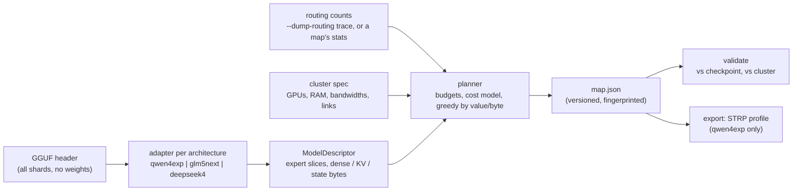

# MoE expert placement maps

A planner that decides which routed experts of a mixture-of-experts checkpoint live in which GPU's VRAM and which
stay in bounded host RAM, and a versioned map file that records the decision and the measurements it came from, so
a map can be shared, re-validated and re-planned elsewhere. Code: `tools/moe_placement/`, CLI `tools/moe_place.py`,
tests `tools/test_moe_placement.py` (stdlib only, no GPU, no download).

**What this is not.** A map does not make a model runnable. The Strata engine implements one architecture
(`qwen4exp`, Qwen3.8-Flash-Next and its variants, 48 layers x 512 experts). For GLM-5.3-Flash (`glm5next`) and
DeepSeek V4 Flash (`deepseek4`) the planner produces budgets and placements, and the exporter **refuses** to hand
them to the engine; see [what is missing](#what-is-missing-for-real-glm--deepseek-inference).

## What it keeps from the engine

The engine already has the mechanism; this generalizes how its inputs are made, it does not replace it.

| engine piece | what it does | how the planner uses it |
|---|---|---|
| expert arena + `ExpertLayout` (`include/strata/kernels/cpu/expert_layout.hpp`) | host bytes in **canonical** order: `blob_offset(l, e) = layer_offset(l) + e * blob_bytes(l)`; native packs keep each GGUF slice, so blob size varies per layer | same addressing for the RAM tier; per-layer, per-role slice sizes read from the GGUF tensor table |
| residency table (`ExpertCache::slot_of`, `include/strata/core/expert_cache.hpp`) | `[n_layers x n_expert]` int32, canonical id -> VRAM slot or -1; slots of any layer anywhere in one arena | the GPU segment of a plan *is* this table (`ExpertLookup.tier_table`) |
| STRP profile (`--expert-profile`, `tools/make_profile.py`) | ranked (layer, expert) pairs; `--expert-cache N` pre-loads the first N | the exporter writes it byte for byte (tested against `make_profile.write_profile`) |
| adaptive tier, per-layer admission, per-stage residency with `--layer-split` | runtime swaps and splits | untouched; a plan only chooses the starting set |

What Void adds on top of upstream (Task-Parallel Requests, `--slot-context`, shared-prefix checkpoints, fast IQ4
prompt dequant) is orthogonal to placement and is not touched.

## The pipeline



## Adapters

An adapter reads only the header and returns: the MoE layers, each layer's expert tensors (name, ggml type, bytes
of one expert's slice), the dense bytes each layer pins (attention, router, shared experts, norms, dense FFN), KV
bytes per context token, fixed per-sequence state, hash-routed layers and MTP layers. ggml stores an expert tensor
as `[in, out, n_expert]`, so expert `e`'s slice is `offset + e * slice_bytes`.

Read from the real checkpoints' headers (header only; the numbers are the files' own):

| | GLM-5.3-Flash UD-IQ3_XXS | DeepSeek V4 Flash Vision Exp UD-IQ3_S |
|---|---|---|
| architecture | `glm5next`, 46 blocks | `deepseek4`, 43 blocks |
| MoE layers | 3-45 (0-2 dense FFN; 45 is the MTP block) | 0-42 (0-2 **hash-routed** by token id) |
| experts | 288, top-8, 1 shared | 256, top-6, 1 shared |
| expert quantization | gate/up mostly IQ2_S, down mostly IQ3_S (mixed per layer) | IQ3_XXS (one layer MXFP4) |
| one expert, all roles | 8.98 MB (most layers) | 9.63 MB (most layers) |
| routed experts total | 112.5 GB | 107.0 GB |
| dense + shared + embeddings | 7.9 GB | 7.4 GB |
| attention | 12 MLA layers (512 latent + pooled indexer key), 34 KDA linear-attention layers (fixed state) | one 512-wide KV head: 128-token window + compressed entries (ratio 4 or 128 per layer) + indexer keys |
| KV, estimated, f16 | 13,056 B/token | 6,880 B/token |

The KV and state figures are **derived from metadata, not measured**: no runtime here executes these layers. They
are recorded as estimates in the map (`provenance.notes`). An unknown architecture is refused; `--allow-generic`
plans it with KV and state left at zero, said so in the notes.

## The map file

`strata.moe-map` version 1, JSON with sorted keys and one line per array (diffs stay readable). Example:
[examples/moe-maps/synthetic-glm5next.map.json](../examples/moe-maps/synthetic-glm5next.map.json), made from a tiny
synthetic checkpoint by the test suite (and checked by it to stay current).

| section | contents |
|---|---|
| `checkpoint` | `fingerprint` (`gguf-layout-v1`: sha256 of the metadata minus `split.*`, and of every tensor's name, type and shape, not offsets: a checkpoint split differently fingerprints the same), optional `content_sample` (sha256 of the first 4 KiB of every expert tensor, for fine-tunes that keep the layout), architecture, name, file type, file names and sizes (never paths) |
| `model` | layers, MoE layers, experts, top-k, shared experts, hidden size, hash-routed and MTP layers |
| `tensors` | per MoE layer and role: tensor name, type, bytes of one expert |
| `stats` | per layer: tokens observed, routing count per expert, optional summed routing weight; the source |
| `placement` | tier names, layer owners, per expert: tier and global rank; per layer: physical order and segments; budgets; the cost-model parameters; expected hit rate; unmeasured layers; remote advice |
| `runtime_support` | informational; recomputed by the adapter on every validation, never trusted from the file |

**Validation** (`validate`, run on every import): a newer major version is refused; counts must be possible
(non-negative, at most tokens x top-k, only on MoE layers); against a checkpoint the architecture and geometry must
match, and the fingerprint and every tensor's type and slice size must match for the placement to be used; physical
order must be a permutation, segments contiguous and in tier order and consistent with per-expert tiers; ranks must
number every expert once; each tier's experts are re-summed and checked against its budget. `--cluster` re-derives
the budgets on the local cluster and refuses a placement that does not fit.

**Sharing.** Statistics transfer, placements do not. A map's routing counts apply to any checkpoint of the same
architecture and geometry (another quantization of the same weights routes the same way to first order):
`plan --stats-from community.map.json` takes them with a note. Its placement is valid only for the fingerprinted
file and a cluster at least as large.

## Ranking and the cost model

The signal is **measured routing frequency** `p(l, e)` = times routed / tokens seen at layer `l`, never weight
magnitude. Per routed activation of one decode token (microseconds):

| where the expert is | cost |
|---|---|
| the GPU that owns the layer | `bytes / mem_GBps` |
| another GPU of the same host | `bytes / mem_GBps + 2 x act_bytes / link_GBps + hop_us` |
| host RAM, computed by the CPU | `bytes / cpu_expert_GBps` |

`act_bytes` is one fp32 hidden vector. An expert's value on a GPU is `p x (cost_RAM - cost_GPU)`; candidates are
taken by value per byte (knapsack density), ties broken by (layer, expert, device), so a plan is reproducible
byte for byte. Experts no GPU takes go to RAM by descending `p`. A layer without statistics is an error unless
`--allow-unmeasured` (uniform prior `k / n_expert`, listed in `unmeasured_layers`); an unmeasured MTP block ranks
coldest (`p = 0`), since it only runs while drafting. `expected` reports the activation-weighted VRAM hit rate and
a modelled expert time per token: **a model, not a measurement**; the engine's own `h` is what counts.

## Budgets

Per GPU, in this order: capacity - runtime reserve - dense bytes of the layers it owns - their KV at
`context_tokens x sequences` - their fixed state; only the rest holds experts. Layer ownership is a contiguous
split proportional to usable VRAM, or explicit (`"dense_split": {"gpu0": "0-15", ...}`). Output head and other
global tensors go with the last layer; `token_embd` stays in host memory (a row lookup). Host RAM: capacity -
reserve - embeddings, and it **must** hold every expert no GPU holds. There is no NVMe tier (unqualified): a plan
that does not fit is refused with the shortfall, never spilled. The Strata RAM expert tier on SYCL is a separate
runtime feature with its own open multi-stream verification failure; a plan that puts experts in RAM describes
where a runtime *would* compute them, it does not enable that tier.

## Indexing and lookup: why reordering is exact

Per MoE layer the plan stores `P` (physical index -> canonical id), hot first, grouped into contiguous segments
`(tier, start, count)` in tier order. The lookup keeps the inverse `Q` (canonical id -> physical index):

```
phys          = Q[layer][e]                       e = the router's canonical expert id
tier, start   = the segment containing phys
index_in_tier = phys - start                      address = tier_base[layer] + index_in_tier * expert_bytes(layer)
```

Everything that depends on an expert's identity stays canonical: router logits and the selection bias
(`exp_probs_b`), a hash-routed layer's token -> expert table (`ffn_gate_tid2eid`), the top-k set and its order, the
routing weights and the order expert outputs are summed. Only the address the weights are read from goes through
`Q`. The same products are then summed in the same order, so the output is **bit-identical**: the test runs a
sigmoid-routed, bias-selected, normalized top-k MoE (and a hash-routed one) against both layouts and compares with
`==`, not a tolerance. Accumulating in *physical* order would break that, and is the one thing a runtime must not
do. Strata's residency table is `Q` restricted to one GPU segment (`tier_table`), so a contiguous physical layout
is optional for Strata's VRAM tier (slots are addressed through the table) and matters where a runtime needs one
tensor per tier, e.g. splitting a GGUF expert tensor into hot and cold halves.

## Across hosts

Two different things, kept apart:

- **llama.cpp RPC** (what the existing GLM/DeepSeek distributed profiles use) places whole tensors on a remote
  backend. An expert tensor holds all of a layer's experts, so its granularity is **one layer's experts**, and
  every token pays one activation round trip per remote layer boundary.
- **Native Strata** has no cross-host transport. Its multi-GPU paths (`--layer-split`, `--peer-device`,
  `--expert-cache-device1..3`) are within one host. Nothing here creates one, and per-expert remote placement is
  therefore never produced.

The planner reports `remote_advice`: per remote GPU, the MoE layers whose whole expert set would cost less there
(remote compute plus `2 x act_bytes / link_GBps + rtt_us` per token) than where the plan keeps them, as many as fit,
labelled with the link's transport. The transfer term is a lower bound: one hidden vector each way (16 KiB fp32 for
a 4096-wide model, ~55 us at 0.6 GB/s, ~205 us with a 150 us RTT); a runtime that ships each selected expert's output
back separately, or a hyper-connection model cut at a layer boundary (4 x the hidden width), moves more. Only layers
whose local experts are mostly in RAM qualify. It is advice for a runtime that places whole tensors remotely; it is
not executed.

## Usage

```bash
python tools/moe_place.py inspect MODEL-00001-of-00004.gguf
python tools/moe_place.py plan MODEL-00001-of-00004.gguf --cluster my-cluster.json --trace routing.bin --out model.map.json
python tools/moe_place.py validate model.map.json --gguf MODEL-00001-of-00004.gguf --cluster my-cluster.json
python tools/moe_place.py export-strp model.map.json --gguf MODEL.gguf --out data/expert-profile.bin
```

`export-strp` prints the matching `--expert-profile` / `--expert-cache N` arguments. The engine distributes ranks
after GPU 0's over `--expert-cache-device1..3` its own way (striped or by layer), so the per-GPU split past GPU 0
is a suggestion there. Cluster specs: [examples/moe-maps/cluster.example.json](../examples/moe-maps/cluster.example.json)
(sizes accept `"32GiB"`, `"64GB"` or bytes; bandwidths are GB/s).

## What is missing for real GLM / DeepSeek inference

In order, each a prerequisite of the next:

1. **Routing statistics.** None exist for either model: Strata cannot run them, and llama.cpp has no built-in routing dump.
   Plans for them today use `--allow-unmeasured`, which ranks nothing. Next step: a routing dump from the llama.cpp
   build behind the existing profiles (a graph callback on the `ffn_moe_topk` tensor writing the format
   `stats.read_strata_trace` reads), run on representative text. DeepSeek's hash-routed layers 0-2 need text
   matching the deployment's token distribution.
2. **Engine layers.** Strata's geometry is fixed (`include/strata/core/layout.hpp`, `include/strata/plan/plan.hpp`:
   48 x 512, GDN + QSA). GLM needs KDA linear attention, MLA with an indexer, 4-way hyper-connections, sigmoid
   routing with bias, 288 experts; DeepSeek V4 needs compressed sparse attention with an indexer, hash routing,
   hyper-connections, 256 experts. Each is new SYCL kernels plus a parity test against llama.cpp.
3. **Generic geometry in the engine.** `ExpertCache`, `ExpertLayout` and the STRP reader already take `n_layers` /
   `n_expert` as parameters; `ModelGeometry` and `plan::Geometry` do not, and the native expert format list
   (`native_experts.txt`) would need IQ2_S, MXFP4 and Q2_K/Q3_K expert kernels on SYCL.
4. **Per-GPU honouring of a plan** past GPU 0 (`--expert-cache-device1..3` take counts, not sets).
5. **Measured KV/state sizes** to replace the adapters' estimates, from the first runtime that executes the layers.
